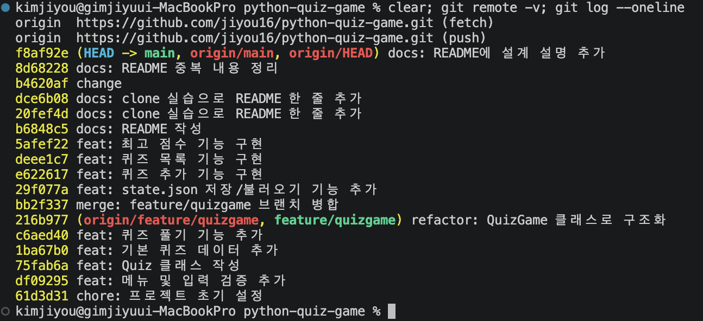
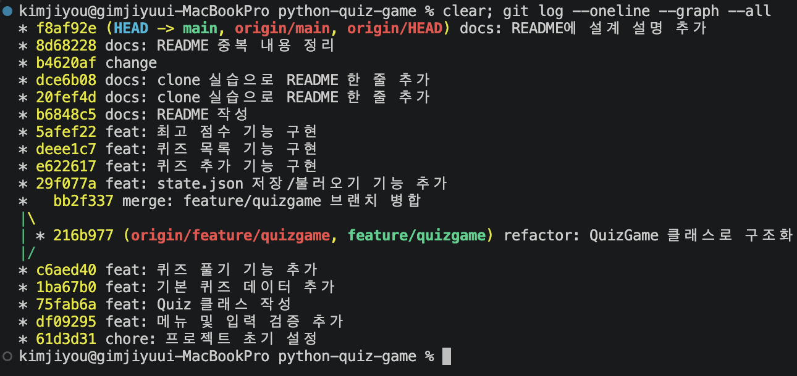
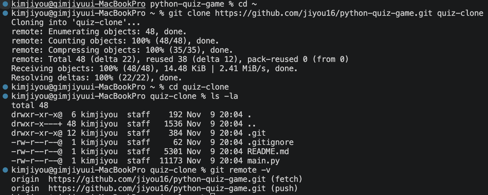
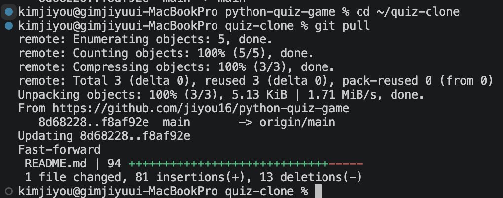
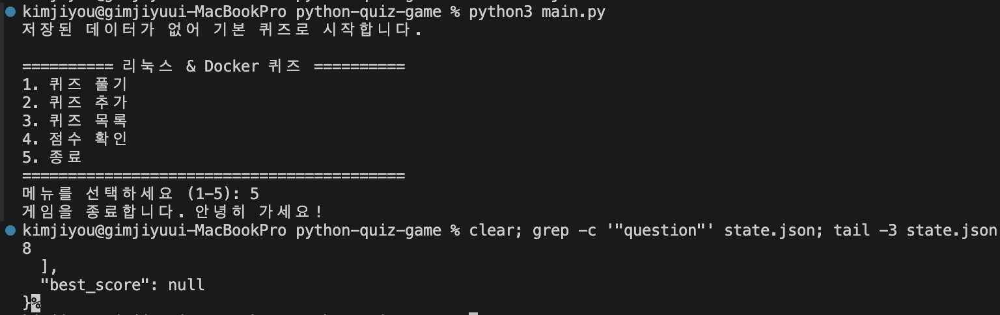
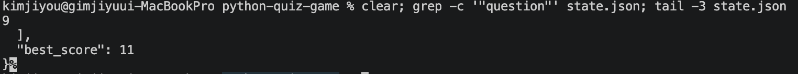
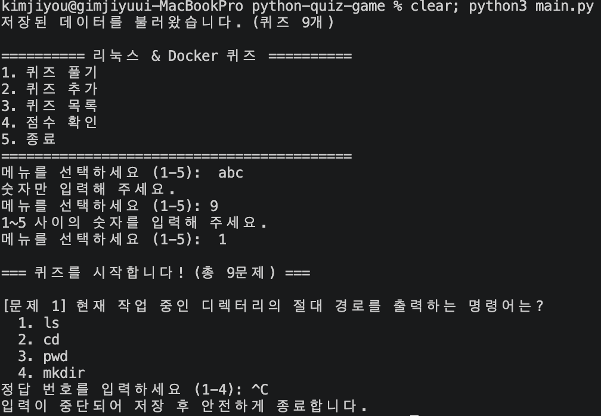
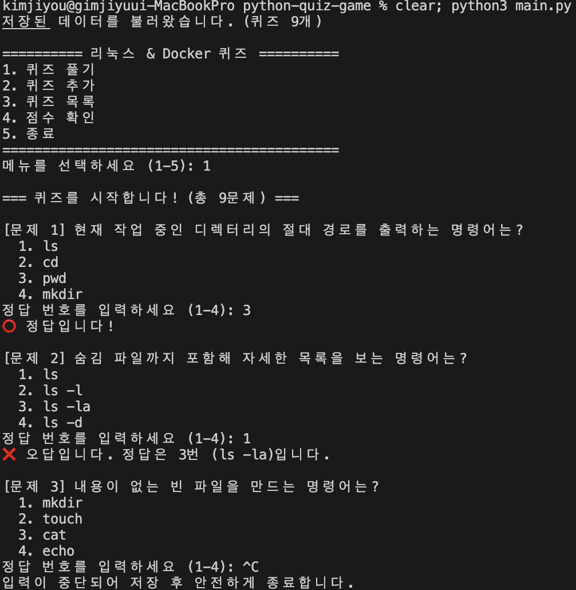
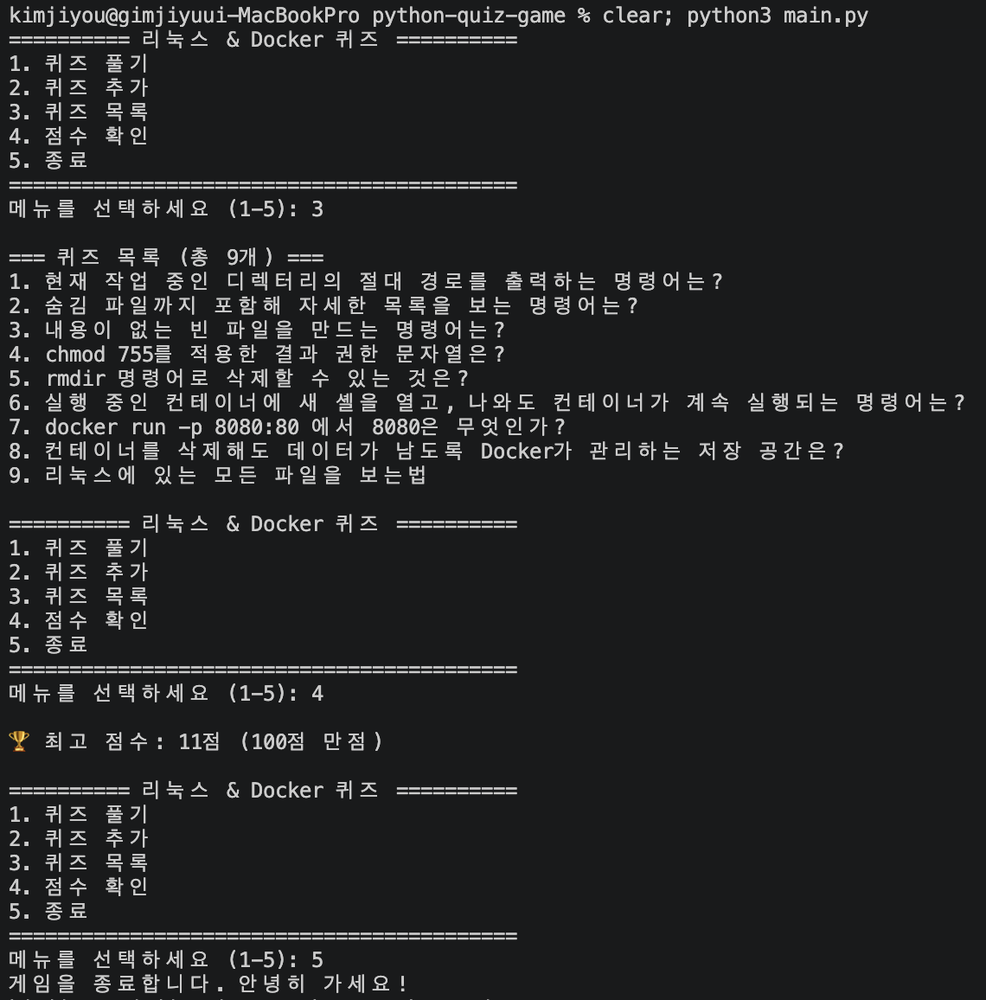

# 리눅스 & Docker 기초 퀴즈 게임

- 원격 저장소: https://github.com/jiyou16/python-quiz-game

## 프로젝트 개요

터미널에서 실행하는 Python 퀴즈 게임입니다.
메뉴에서 번호를 선택해 퀴즈를 풀고, 새 퀴즈를 추가하고, 퀴즈 목록과 최고 점수를 확인할 수 있습니다.
퀴즈와 최고 점수는 `state.json` 파일에 저장되어 프로그램을 종료했다가 다시 실행해도 유지됩니다.

- 언어: Python 3 (표준 라이브러리만 사용, 별도 설치 불필요)
- 구조: `Quiz`(퀴즈 한 문제), `QuizGame`(게임 전체 관리) 두 개의 클래스
- 버전 관리: Git / GitHub

## 퀴즈 주제와 선정 이유

**주제: 리눅스 & Docker 기초**

이전 미션(개발 워크스테이션 구축)에서 VS Code 터미널과 Docker로 직접 실습한
리눅스 명령어, 파일 권한, Docker 컨테이너 개념을 복습하기 위해 선택했습니다.
퀴즈를 만들면서 한 번, 테스트하면서 또 한 번 풀게 되어 자연스럽게 복습이 됩니다.

## 실행 방법

```bash
git clone https://github.com/jiyou16/python-quiz-game.git
cd python-quiz-game
python3 main.py
```

- Python 3.8 이상에서 동작합니다.
- 처음 실행하면 `state.json`이 없으므로 기본 퀴즈 8개로 시작하고, 파일이 자동으로 생성됩니다.

## 기능 목록

| 메뉴 | 기능 | 설명 |
|---|---|---|
| 1 | 퀴즈 풀기 | 저장된 퀴즈를 순서대로 출제하고 정답/오답을 알려 줍니다. 끝나면 100점 만점 점수를 보여 주고 최고 점수와 비교해 갱신합니다. |
| 2 | 퀴즈 추가 | 문제, 선택지 4개, 정답 번호(1~4)를 입력받아 새 퀴즈를 등록하고 바로 파일에 저장합니다. |
| 3 | 퀴즈 목록 | 저장된 퀴즈의 문제를 번호와 함께 보여 줍니다. |
| 4 | 점수 확인 | 최고 점수를 보여 줍니다. 아직 퀴즈를 풀지 않았다면 안내 메시지를 출력합니다. |
| 5 | 종료 | 데이터를 저장하고 프로그램을 종료합니다. |

### 입력 및 예외 처리

- 입력 앞뒤 공백을 제거한 뒤 처리합니다.
- 빈 입력, 숫자가 아닌 입력(예: `abc`), 범위 밖 숫자(예: 메뉴 `9`, 정답 `0`)는 안내 후 다시 입력받습니다.
- `Ctrl+C`(KeyboardInterrupt)나 입력 종료(EOFError)가 발생하면 저장 후 안전하게 종료합니다.
- 퀴즈가 하나도 없을 때 퀴즈 풀기나 목록을 선택하면 안내 메시지를 출력합니다.

## 파일 구조

```
python-quiz-game/
├── main.py         # 프로그램 전체 코드 (Quiz, QuizGame 클래스 포함)
├── README.md       # 프로젝트 설명
├── .gitignore      # Git이 추적하지 않을 파일 목록
├── docs/images/    # README에 넣은 실행 화면 스크린샷
└── state.json      # 실행 시 자동 생성되는 데이터 파일 (Git에는 올리지 않음)
```

### main.py 구성

| 이름 | 종류 | 역할 |
|---|---|---|
| `Quiz` | 클래스 | 퀴즈 한 문제(문제, 선택지, 정답). 출력, 정답 확인, 딕셔너리 변환 메서드 |
| `get_default_quizzes()` | 함수 | 기본 퀴즈 8개를 `Quiz` 객체 리스트로 반환 |
| `ask_number()` | 함수 | 범위 안의 숫자를 입력받을 때까지 반복 |
| `ask_text()` | 함수 | 비어 있지 않은 문자열을 입력받을 때까지 반복 |
| `QuizGame` | 클래스 | 퀴즈 목록과 최고 점수를 관리. 메뉴, 퀴즈 풀기/추가/목록, 점수 확인, 저장/불러오기 |

## 설계 설명

### 클래스를 사용한 이유

- **데이터와 동작을 한 곳에 묶기:** `Quiz`는 문제·선택지·정답(데이터)과 출력·정답 확인(동작)을 함께 가집니다. 정답 판정 방식이 바뀌어도 `Quiz.is_correct()` 한 곳만 고치면 됩니다.
- **상태를 객체가 보관:** 퀴즈 목록과 최고 점수는 여러 메뉴가 함께 쓰는 "게임 상태"입니다. `QuizGame`의 속성(`self.quizzes`, `self.best_score`)에 두면 메서드끼리 매개변수로 주고받거나 전역 변수를 쓰지 않아도 같은 상태를 공유할 수 있습니다.
- **함수형 대안과 비교:** 퀴즈를 딕셔너리로, 기능을 함수로만 만들 수도 있습니다. 규모가 작을 때는 충분하지만, 기능이 늘수록 모든 함수가 `quizzes`, `best_score`를 매개변수로 받아 다시 돌려줘야 하고, 딕셔너리 키 오타(`"answr"`)도 실행해 봐야 알 수 있습니다. 이 프로젝트는 상태를 계속 유지하며 메뉴를 반복하는 구조라 클래스가 더 자연스럽다고 판단했습니다.
- **상태가 없는 기능은 함수로 유지:** `ask_number()`, `ask_text()`는 저장할 상태가 없고 어디서나 재사용하는 도구라서 클래스 밖의 함수로 두었습니다.

### 입력 검증과 데이터 I/O의 분리

| 구분 | 담당 | 책임 | 하지 않는 일 |
|---|---|---|---|
| 사용자 입력 검증 | `ask_number()`, `ask_text()` | 키보드 입력의 공백 제거, 빈 값·숫자 아님·범위 밖 처리. **검증을 통과한 값만 반환** | 파일 읽기/쓰기, 게임 상태 변경 |
| 파일 데이터 검증 | `Quiz.from_dict()` | state.json에서 읽은 퀴즈 한 개의 형식(문제 문자열, 선택지 4개, 정답 1~4) 확인. 이상하면 `ValueError` | 사용자 입력, 파일 열기 |
| 데이터 I/O | `QuizGame.load()`, `save()`, `reset_to_default()` | state.json 열기/쓰기, UTF-8 인코딩, 파일 없음·손상·읽기 오류를 `try/except`로 처리하고 기본 퀴즈로 복구 | 사용자에게 값 입력받기 |
| 게임 로직 | `play_quiz()`, `add_quiz()` 등 | 위 함수들을 조합해 기능 수행 | 직접 입력 검증이나 파일 처리 |

**나눈 기준:** 데이터가 **어디서 들어오는지**(키보드 vs 파일)와 **무엇을 하는지**(검증 vs 저장)로 나눴습니다. 키보드 입력은 잘못되면 다시 물어보면 되지만, 파일 데이터는 잘못되면 다시 물어볼 수 없어서 기본값으로 복구해야 합니다. 대응 방식이 다르기 때문에 분리했습니다. 덕분에 게임 로직은 "이미 검증된 값"만 받아 기능에 집중할 수 있습니다.

## 데이터 파일 설명 (state.json)

- **경로:** 프로젝트 루트(`main.py`와 같은 폴더)의 `state.json`
- **역할:** 퀴즈 목록과 최고 점수를 저장해, 프로그램을 다시 실행해도 데이터가 유지되게 합니다.
- **인코딩:** UTF-8 (한글이 그대로 보이도록 `ensure_ascii=False`로 저장)
- **저장 시점:** 퀴즈 추가 직후, 최고 점수 갱신 직후, 메뉴 5번 종료 시, `Ctrl+C` 중단 시
- **Git 관리:** 실행할 때마다 내용이 바뀌는 데이터라 `.gitignore`에 넣어 업로드하지 않습니다.

### 스키마

```json
{
  "quizzes": [
    {
      "question": "현재 작업 중인 디렉터리의 절대 경로를 출력하는 명령어는?",
      "choices": ["ls", "cd", "pwd", "mkdir"],
      "answer": 3
    }
  ],
  "best_score": 100
}
```

| 키 | 타입 | 설명 | 이렇게 설계한 이유 |
|---|---|---|---|
| `quizzes` | list | 퀴즈 목록 | 퀴즈 개수가 추가로 계속 늘어나고, **출제 순서**가 유지되어야 하므로 순서가 있는 리스트를 사용 |
| `quizzes[].question` | str | 문제 | 화면에 그대로 출력할 텍스트 |
| `quizzes[].choices` | list[str] | 선택지 4개 | 순서가 곧 선택지 번호(인덱스 + 1)가 되므로 리스트로 저장. 4개로 고정해 검증이 단순함 |
| `quizzes[].answer` | int | 정답 번호 (1~4) | 사용자 입력도 번호이므로 숫자끼리 바로 비교 가능. 정답을 텍스트로 저장하면 오타·띄어쓰기에 취약 |
| `best_score` | int 또는 null | 최고 점수 (100점 만점) | 퀴즈를 추가하면 문제 수가 바뀌므로 맞힌 개수가 아닌 **100점 만점 점수**로 저장. "아직 안 풀었음"과 "0점"을 구분하려고 기록 없음은 `null` |

### 파일이 없거나 손상된 경우

- **파일이 없을 때(첫 실행):** 기본 퀴즈 8개로 시작하고 `state.json`을 새로 만듭니다.
- **파일이 손상됐을 때:** JSON 형식 오류, 키 누락, 잘못된 값(예: 정답이 5)이 있으면 안내 메시지를 출력하고 기본 퀴즈로 복구합니다.

### 데이터가 커질 때의 한계와 대안

- **한계:** 지금 방식은 실행할 때 파일 전체를 읽고, 저장할 때마다 파일 전체를 다시 씁니다. 퀴즈가 수만 개로 늘면 시작과 저장이 느려지고 메모리도 많이 씁니다. 또 여러 사람이 동시에 저장하면 서로 덮어쓸 수 있고, 저장 도중 프로그램이 꺼지면 파일이 깨질 수 있습니다.
- **대안:**
  - **SQLite 데이터베이스:** Python에 내장된 `sqlite3`로 바꾸면 필요한 퀴즈만 조회하고 한 줄씩 추가·수정할 수 있으며, 트랜잭션으로 저장 중 손상도 막을 수 있습니다.
  - **안전한 저장:** 임시 파일에 먼저 쓴 뒤 `os.replace()`로 바꿔치기하면 저장 도중 꺼져도 기존 파일이 보존됩니다.
  - **사용자가 많아질 때:** PostgreSQL, MySQL 같은 서버형 데이터베이스를 사용합니다.

## Git 작업 기록

- 기능 단위로 커밋했습니다. (메뉴 → Quiz 클래스 → 기본 데이터 → 퀴즈 풀기 → 구조화 → 저장 → 추가 → 목록 → 점수 → README)
- clone 실습: 별도 폴더(`quiz-clone`)에 저장소를 clone해 README를 수정하고 push한 뒤, 원래 폴더에서 `git pull`로 가져왔습니다.

### 브랜치 분리 이유와 병합 시 고려점

`feature/quizgame` 브랜치에서 QuizGame 클래스 구조화 작업을 한 뒤 `main`에 병합했습니다.

- **분리한 이유 (기능 격리):** 구조화는 함수들을 클래스로 옮기는 큰 변경이라 중간에 프로그램이 동작하지 않는 상태가 생길 수 있습니다. 브랜치에서 작업하면 `main`은 항상 실행 가능한 상태로 남고, 작업이 실패해도 브랜치만 버리면 됩니다.
- **병합 전 확인:** 브랜치에서 메뉴, 퀴즈 풀기, 잘못된 입력, 종료가 모두 동작하는지 테스트한 뒤 병합했습니다.
- **`--no-ff` 사용:** fast-forward로 병합하면 브랜치를 썼다는 흔적이 사라집니다. `git merge --no-ff`로 병합 커밋을 남겨 어떤 작업이 브랜치에서 진행됐는지 그래프로 확인할 수 있게 했습니다.
- **충돌 대비:** 병합 전에 `main`에 다른 변경이 있으면 같은 줄을 고친 부분에서 충돌이 날 수 있습니다. 브랜치 작업 기간을 짧게 하고, 병합 전 `git status`로 작업 트리가 깨끗한지 확인했습니다.

## 실행 화면

### 원격 저장소와 커밋 목록 (`git remote -v`, `git log --oneline`)


### 브랜치와 병합 이력 (`git log --oneline --graph --all`)


### clone한 폴더


### git pull 결과


### state.json 변경 전 (첫 실행 직후: 퀴즈 8개, 최고 점수 없음)


### state.json 변경 후 (퀴즈 추가 + 퀴즈 풀이 후 종료)


### 입력 예외 처리 흐름 (공백, 빈 입력, 문자, 범위 밖 숫자)


### 정답 판정 예시


### 메뉴와 주요 기능 (추가, 목록, 점수 확인, 종료)

## 커밋 기록

총 커밋 수: **18개** (이 섹션을 추가하기 직전 기준, merge 커밋 포함)

```
$ git rev-list --count HEAD
18

$ git log --oneline
4865112 docs: 실행 화면 스크린샷 추가
f8af92e docs: README에 설계 설명 추가
8d68228 docs: README 중복 내용 정리
b4620af change
dce6b08 docs: clone 실습으로 README 한 줄 추가
20fef4d docs: clone 실습으로 README 한 줄 추가
b6848c5 docs: README 작성
5afef22 feat: 최고 점수 기능 구현
deee1c7 feat: 퀴즈 목록 기능 구현
e622617 feat: 퀴즈 추가 기능 구현
29f077a feat: state.json 저장/불러오기 기능 추가
bb2f337 merge: feature/quizgame 브랜치 병합
216b977 refactor: QuizGame 클래스로 구조화
c6aed40 feat: 퀴즈 풀기 기능 추가
1ba67b0 feat: 기본 퀴즈 데이터 추가
75fab6a feat: Quiz 클래스 작성
df09295 feat: 메뉴 및 입력 검증 추가
61d3d31 chore: 프로젝트 초기 설정
```
